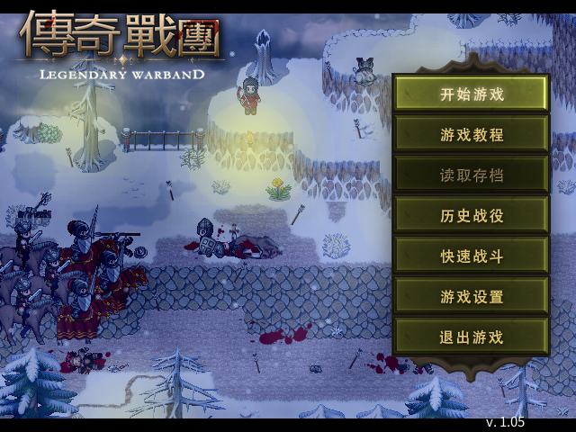
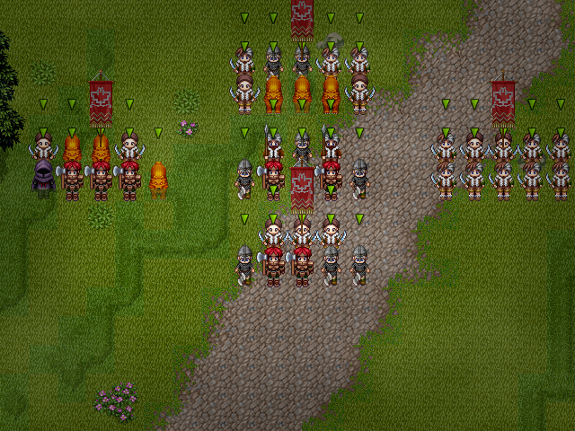

# vkxp

A Rust + Vulkan runtime for RPG Maker XP (RGSS1) games on Linux. `vkxp <game directory>` runs
the game's scripts in an embedded Ruby 1.8.7 interpreter against the RGSS classes and shows
the frames of a Vulkan compositor in a window, or writes them to files in a headless run.

[](https://github.com/xuyanwen2012/vkxp/actions/workflows/ci.yml)
[](LICENSE)

<p align="center">
  
  
</p>

The pictures are frames of [Legendary Warband](https://github.com/xuyanwen2012/XP-MBBS-7.0),
an RPG Maker XP game, as vkxp renders them in a headless run.

## Status

Version 0.1.0 is the first public release.

What works:

- A window with integer or filtered scaling and borderless fullscreen, and frame pacing at
  the game's frame rate.
- Audio: Ogg Vorbis, WAV, MP3 and, with a SoundFont, MIDI.
- Keyboard and gamepads, with key maps that can be changed.
- Encrypted archives (`Game.rgssad`).
- Configuration files for the user and for a game, besides the command line.
- Fast-forward, input recording and replay, and save states that work in any game.
- A headless mode that writes chosen frames as PNG files and is reproducible byte for byte.

Exactness: frames are compared with those of the original runtime, which `cargo xtask oracle`
runs under Wine. On the seven community-made games used as the regression corpus, the frames
compared are pixel-identical except for text glyphs. Many rules were measured on the original
runtime; the specifications under [`openspec/specs`](openspec/specs) record them.

Known gaps:

- Text glyphs are not rasterised as Windows GDI rasterises them, so the pixels of text
  differ; layout and advance widths are kept.
- Linux x86_64 only.

[docs/compatibility.md](docs/compatibility.md) has the full list.

## Quick start

Prerequisites: a C compiler, `glslc`, `spirv-val`, the development files of libcrypt, ALSA
and libudev, and a Vulkan 1.3 device; see [docs/building.md](docs/building.md).

Build:

```sh
cargo build --release -p vkxp
```

The built-in scripts. A game expects the `RPG` module of the original runtime. That Ruby
source is Enterbrain's and is not part of this repository; one command copies it from an RGSS
DLL of your own into a file that `vkxp` loads:

```sh
mkdir -p ~/.local/share/vkxp
cargo xtask extract-rpg <RGSS DLL> ~/.local/share/vkxp/rpg_builtin.rb
```

Run a game, naming the directory of the run-time package if the game uses one:

```sh
target/release/vkxp <game directory> --rtp Standard=<RTP directory>
```

The Vulkan loader loads the driver of every GPU in the machine unless it is restricted; to
leave the others alone, set `VK_LOADER_DRIVERS_SELECT` and `--device`, for example
`VK_LOADER_DRIVERS_SELECT='*radeon*'` with `--device RADV`.

The main keys:

| Key | |
|---|---|
| Arrow keys | Directions |
| Space, Enter, C | Confirm (C) |
| Escape, X | Cancel (B) |
| Shift, Z | A |
| Tab held | Fast-forward |
| F12 | Reset |
| Alt+Enter, F11 | Borderless fullscreen |
| F2 | Frame rate in the title |
| F3, F4 | Save and load a state; with Shift, choose the slot |

Every option, the configuration files and the key maps are in
[docs/running.md](docs/running.md).

## How it works

The game's scripts, with the interpreter, the bitmaps and the game's files, are the guest;
the window, the GPU, the audio device and the input are the host. The two exchange only plain
data defined in `vkxp-proto`, and the guest runs as a thread or as a process of its own.

| Crate | Responsibility | Side |
|---|---|---|
| `vkxp-proto` | Plain data shared by both sides: frame packet, op list, audio commands, input snapshot | shared |
| `vkxp-pixel` | Bit-exact pixel arithmetic with its provenance | shared |
| `vkxp-core` | Value types, bitmaps, scene objects, frame extraction | guest |
| `vkxp-image` | PNG, JPEG, BMP decoding | guest |
| `vkxp-text` | Font lookup, substitution table, glyph rasterisation | guest |
| `vkxp-vfs` | Path resolution, RTP lookup, encrypted archive | guest |
| `vkxp-ruby-sys` | Build of the embedded Ruby and raw FFI | guest |
| `vkxp-binding` | RGSS Ruby API on top of core | guest |
| `vkxp-compose-ref` | CPU reference compositor | host and tests |
| `vkxp-vk` | Vulkan backend | host |
| `vkxp-audio` | Mixer, decoding, MIDI synthesis | host |
| `vkxp-host` | Event loop, input mapping, thread orchestration, configuration | host |
| `vkxp` | Executable | |

Each frame the guest sends an ordered list of ops. There are two compositors: the Vulkan
backend evaluates the list per pixel in one compute dispatch with integer arithmetic, and a
CPU reference compositor in pure Rust evaluates the same list. The tests render every
message stream with both and require byte-identical frames.

## Documentation

- [docs/running.md](docs/running.md): running a game, every option, configuration files,
  gamepads, audio, the headless mode, save states, recordings, and the demo.
- [docs/building.md](docs/building.md): prerequisites and how the tests choose a Vulkan
  device.
- [docs/architecture.md](docs/architecture.md): the crates, the protocol and the dependency
  rules.
- [docs/development.md](docs/development.md): the merge gate, the checks outside it,
  comparing with the original runtime, and the OpenSpec workflow.
- [docs/compatibility.md](docs/compatibility.md): what is exact and the known differences.
- [docs/decisions.md](docs/decisions.md): the settled design decisions.
- [docs/releasing.md](docs/releasing.md): making a release and checking its package.
- [CHANGELOG.md](CHANGELOG.md) and [CONTRIBUTING.md](CONTRIBUTING.md).

## Legal

vkxp is an independent project. It is not affiliated with, endorsed by or sponsored by
Enterbrain, KADOKAWA or Gotcha Gotcha Games. RPG Maker is a trademark of its owner. The
repository contains no code, script or asset of the original runtime or of the run-time
package; to run a game you need the game and the files it requires.

## Licence

MIT; see [LICENSE](LICENSE). The bundled third-party source keeps its own terms, which
[THIRD-PARTY.md](THIRD-PARTY.md) lists.
