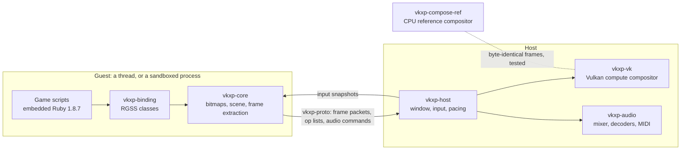

<p align="center"></p>

<h1 align="center">vkxp</h1>

<p align="center"><b>Classic RPG Maker. Modern Rust + Vulkan.</b><br>The games of RPG Maker XP and VX on Linux, pixel for pixel.</p>

<p align="center">
  <a href="https://www.rust-lang.org/"></a>
  <a href="https://doc.rust-lang.org/edition-guide/rust-2024/"></a>
  <a href="https://www.vulkan.org/"></a>
  
  <br>
  <a href="https://github.com/xuyanwen2012/vkxp/actions/workflows/ci.yml"></a>
  <a href="https://github.com/xuyanwen2012/vkxp/releases/latest"></a>
  <a href="LICENSE"></a>
</p>

A Rust + Vulkan runtime for RPG Maker games on Linux. RPG Maker XP (RGSS1) and VX (RGSS2)
are supported; VX Ace (RGSS3) is planned and does not run yet. `vkxp <game directory>` runs
the game's scripts in an embedded Ruby 1.8.7 interpreter against the RGSS classes and shows
the frames of a Vulkan compositor in a window, or writes them to files in a headless run.

## Classic RPG Maker

| Runtime | State | |
|---|---|---|
| RPG Maker XP (RGSS1) | Supported | Since version 0.1.0 |
| RPG Maker VX (RGSS2) | Supported | Since version 0.2.0 |
| RPG Maker VX Ace (RGSS3) | Planned | Does not run yet; in progress |

<p align="center">
  
  
</p>

The pictures are frames of [Legendary Warband](https://github.com/xuyanwen2012/XP-MBBS-7.0),
an RPG Maker XP game, as vkxp renders them in a headless run.

The runtime is taken from the game's `Game.ini`. What works:

- A window with integer or filtered scaling and borderless fullscreen, and frame pacing at
  the game's frame rate.
- Audio: Ogg Vorbis, WAV, MP3 and MPEG layer II, with a SoundFont MIDI, and with `ffmpeg`
  installed WMA.
- Keyboard and gamepads, with key maps that can be changed.
- Encrypted archives (`Game.rgssad`, `Game.rgss2a`).
- Configuration files for the user and for a game, besides the command line.
- Fast-forward, input recording and replay, and save states that work in any game.
- A headless mode that writes chosen frames as PNG files and is reproducible byte for byte.

**Exactness.** Frames are compared with those of the original runtime, which
`cargo xtask oracle` runs under Wine. On the seven community-made games used as the
regression corpus, the frames compared are pixel-identical except for text glyphs. Two games
of RPG Maker VX were compared in the same way, Visions & Voices and The Witch's House: the
title, the menu, maps, a battle and the screens of saving and loading equal the original
outside the rectangles of text, and a save of The Witch's House written at the same frame is
byte for byte that of the original. Many rules were measured on the original runtime; the
specifications under [`openspec/specs`](openspec/specs) record them.

**Known gaps.** [docs/compatibility.md](docs/compatibility.md) has the full list.

- Text glyphs are not rasterised as Windows GDI rasterises them, so the pixels of text
  differ; layout and advance widths are kept.
- Linux x86_64 only.

## Modern Rust + Vulkan

- **Raw Vulkan 1.3 through `ash`, no engine in between.** The compositor is one compute
  shader, [`compose.comp`](crates/vkxp-vk/shaders/compose.comp): one dispatch per frame, one
  workgroup per 16 by 16 tile, one invocation per pixel, integer arithmetic only and texels
  fetched, never filtered, so a frame is the same on every device.
- **Two compositors that must agree.** A CPU reference compositor in pure Rust evaluates the
  same op list; the tests render every message stream with both and require byte-identical
  frames.
- **Current Vulkan, used.** Dynamic rendering, `synchronization2` and descriptor indexing are
  required. `VK_EXT_present_timing` with `VK_KHR_present_wait2` paces presents at the game's
  frame rate and `VK_EXT_swapchain_maintenance1` replaces the swapchain, each where the
  device offers it and with a fallback where it does not.
- **Validated in CI.** The Vulkan tests run on lavapipe, the software rasteriser of Mesa,
  with the Khronos validation layer, and a validation error fails the test.
- **`unsafe` has an address.** `#![forbid(unsafe_code)]` holds in the core, the protocol,
  the pixel arithmetic, the reference compositor, the decoders, the audio and the host;
  `unsafe` lives in the Vulkan backend, the Ruby FFI, the binding, the guest role and
  platform code.
- **Boundaries that a test keeps.** Guest and host exchange only plain data, and
  `cargo xtask deps` checks the crate graph against `cargo metadata`.
- **The C that remains is watched.** The vendored Ruby runs its upstream test suites; outside
  the merge gate they run again under AddressSanitizer and UndefinedBehaviorSanitizer, with
  libFuzzer targets (`cargo xtask fuzz`) and a stress run of the garbage collector
  (`cargo xtask stress`).

## Quick start

Prerequisites: a C compiler, `glslc`, `spirv-val`, the development files of libcrypt, ALSA
and libudev, and a Vulkan 1.3 device; see [docs/building.md](docs/building.md). The Rust
toolchain is pinned in `rust-toolchain.toml`.

```sh
cargo build --release -p vkxp
```

The built-in scripts. A game expects the `RPG` module of the original runtime. That Ruby
source is Enterbrain's and is not part of this repository; one command copies it from an RGSS
DLL of your own into a file that `vkxp` loads. A game of VX needs those of RGSS2 in a file
of their own; [docs/running.md](docs/running.md) says how.

```sh
mkdir -p ~/.local/share/vkxp
cargo xtask extract-rpg <RGSS DLL> ~/.local/share/vkxp/rpg_builtin.rb
```

Run a game, naming the directory of the run-time package if the game uses one:

```sh
target/release/vkxp <game directory> --rtp Standard=<RTP directory>
```

The Vulkan loader loads the driver of every GPU in the machine unless it is restricted; to
leave the others alone, set `VK_LOADER_DRIVERS_SELECT` and `--device`, for example
`VK_LOADER_DRIVERS_SELECT='*radeon*'` with `--device RADV`.

| Key | |
|---|---|
| Arrow keys | Directions |
| Space, Enter, C | Confirm (C) |
| Escape, X | Cancel (B) |
| Shift, Z | A |
| Tab held | Fast-forward |
| F12 | Reset |
| Alt+Enter, F11 | Borderless fullscreen |
| F2 | Frame rate in the title |
| F3, F4 | Save and load a state; with Shift, choose the slot |

Every option, the configuration files and the key maps are in [docs/running.md](docs/running.md).

## How it works



The game's scripts, with the interpreter, the bitmaps and the game's files, are the guest;
the window, the GPU, the audio device and the input are the host. The two exchange only plain
data defined in `vkxp-proto`, and the guest runs as a thread or as a process of its own. A
guest process confines itself with Landlock before the first script runs: it writes only
below the game directory, executes nothing and opens no TCP connection; `--sandbox off`
turns that off.
The protocol is at version 13, which added the rule set, of RGSS2 or of RGSS3, to the op that
draws a plane of a tilemap.

Each frame the guest sends an ordered list of ops of five kinds, and both compositors
evaluate every kind per pixel. The interpreter is Ruby 1.8.7-p374 with Oniguruma 5.9.6, built
from vendored and patched source by a build script; no installed Ruby is involved. A second
one, Ruby 1.9.2 for RGSS3, is built in `vkxp-ruby192-sys`, and no executable links it yet.
[docs/architecture.md](docs/architecture.md) has every crate and the four dependency rules.

## Documentation

- [docs/running.md](docs/running.md): running a game, every option, configuration files,
  gamepads, audio, the headless mode, save states, recordings, and the demo.
- [docs/building.md](docs/building.md): prerequisites and how the tests choose a Vulkan
  device.
- [docs/architecture.md](docs/architecture.md): the crates, the protocol and the dependency
  rules.
- [docs/development.md](docs/development.md): the merge gate, the checks outside it,
  comparing with the original runtime, and the OpenSpec workflow.
- [docs/compatibility.md](docs/compatibility.md): what is exact and the known differences.
- [docs/decisions.md](docs/decisions.md): the settled design decisions and the milestones.
- [docs/vendored-security.md](docs/vendored-security.md): the security fixes published for
  the vendored Ruby and Oniguruma after their releases, and what was done about each.
- [docs/releasing.md](docs/releasing.md): making a release and checking its package.
- [CHANGELOG.md](CHANGELOG.md): what each version added.

## Contributing

[CONTRIBUTING.md](CONTRIBUTING.md) describes the build, the merge gate
(`VK_LOADER_DRIVERS_SELECT='*lvp*' cargo xtask gate`) and the OpenSpec workflow.

## Licence and legal

MIT; see [LICENSE](LICENSE). The bundled third-party source keeps its own terms, which
[THIRD-PARTY.md](THIRD-PARTY.md) lists.

vkxp is an independent project. It is not affiliated with, endorsed by or sponsored by
Enterbrain, KADOKAWA or Gotcha Gotcha Games. RPG Maker is a trademark of its owner; Rust and
Vulkan are trademarks of the Rust Foundation and of the Khronos Group, named here only to say
what vkxp is built with. The repository contains no code, script or asset of the original
runtime or of the run-time package; to run a game you need the game and the files it requires.
