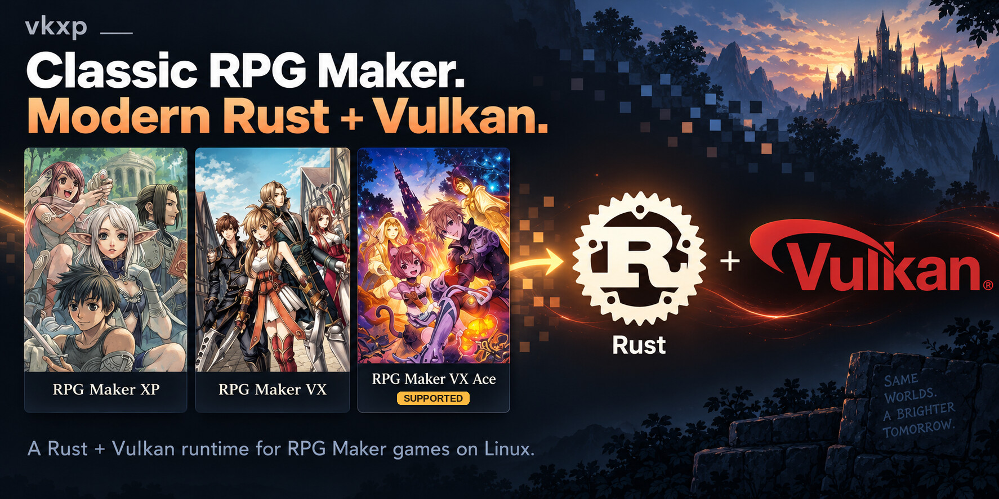
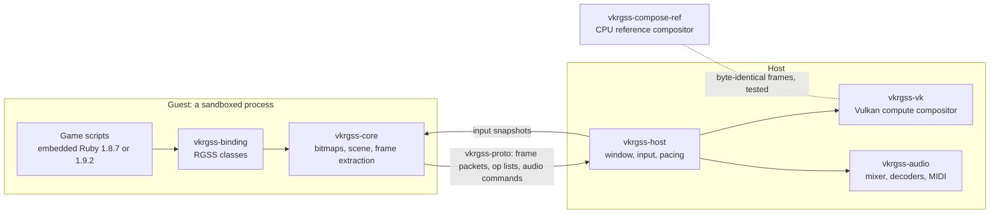

<p align="center"></p>

<h1 align="center">vkrgss</h1>

<p align="center"><b>Classic RPGs. Modern runtime.</b><br>The games of RPG Maker XP, VX and VX Ace, pixel for pixel and byte for byte, on Linux, macOS and Android.</p>

<p align="center">
  <a href="https://www.rust-lang.org/"></a>
  <a href="https://doc.rust-lang.org/edition-guide/rust-2024/"></a>
  <a href="https://www.vulkan.org/"></a>
  <a href="#platforms"></a>
  <br>
  
  
  
  <br>
  <a href="https://github.com/xuyanwen2012/vkrgss-rs/actions/workflows/ci.yml"></a>
  <a href="https://github.com/xuyanwen2012/vkrgss-rs/releases/latest"></a>
  <a href="LICENSE"></a>
</p>

vkrgss runs the games of RPG Maker XP (RGSS1), VX (RGSS2) and VX Ace (RGSS3) without the
original runtime. Their scripts run in an embedded Ruby of the originals' generation, 1.8.7
or for VX Ace 1.9.2, by default in a process of their own, sandboxed on Linux and Android;
every frame is composed by one Vulkan compute dispatch. The result is measured against the
original: compared frames are pixel-identical outside text glyphs, a save written at the same
frame is identical byte for byte, and Linux, macOS and Android phones give the same frames
and saves. Versions 0.1.0 to 0.3.0 were released under the name vkxp (see
[what changed](docs/running.md#coming-from-vkxp-030)).

## Platforms

| Platform | State | How to get it |
|---|---|---|
| Linux x86_64 | Supported | The package of the [latest release](https://github.com/xuyanwen2012/vkrgss-rs/releases/latest), or from source |
| Linux aarch64 | Supported (milestone P1) | The package of the [latest release](https://github.com/xuyanwen2012/vkrgss-rs/releases/latest), or from source |
| macOS 14 or later, Apple silicon | Supported (milestone P2); no package in the release | Build `vkrgss.app` on the Mac |
| Android 14 or later, arm64 | Milestone P3 in progress | The signed APK of the [latest release](https://github.com/xuyanwen2012/vkrgss-rs/releases/latest), through Obtainium, or build it |

This page describes `main`; what came after the latest release is "Unreleased" in [CHANGELOG.md](CHANGELOG.md).
The milestones and their evidence are in [docs/decisions.md](docs/decisions.md#milestones).

## What is new here

### A whole 2D engine in one compute shader, bit-exact on any GPU

The original draws sprites, planes, windows, tilemaps and viewports, with tone, flash,
opacity, blend modes and wave effects. vkrgss turns each frame into an ordered op list and
evaluates it in **one compute dispatch**:
[`compose.comp`](crates/vkrgss-vk/shaders/compose.comp), 16 by 16 tiles, one invocation per
pixel, bindless bitmaps indexed with `nonuniformEXT`. Integer arithmetic only, 64-bit
products emulated, texels never filtered: a frame is the same bytes on every conformant
driver, and a pure-Rust CPU compositor is held byte-identical to it by differential tests.
`VK_EXT_present_timing` schedules each present for the game's own frame time where offered,
and in CI a Khronos validation error, synchronization included, fails the test.

### A closed runtime reproduced by measurement, not by guessing

`cargo xtask oracle` runs the original runtime under Wine in a sandbox, drives it with
scripted input and diffs its frames with vkrgss's, pixel by pixel. Every rule found that way
is a testable requirement in [`openspec/specs`](openspec/specs). A save written at the same
frame is **byte for byte the original's** in a game of XP, of VX and of VX Ace, which takes
the original's Marshal symbol order, random generator and float text exactly. Text is laid
out as GDI under Wine does, with glyphs hinted as Wine's FreeType hints them: all 28,392
measured text sizes agree. Hash seed fixed, random seed and input recorded: replays and
headless PNG frames reproduce byte for byte, and over 3,000 tests rely on it.

### The same frames and saves on every platform

For the ten games compared with the original (seven of XP, one of VX, two of VX Ace), the 84
compared frames are identical pixel for pixel on x86_64 Linux, aarch64 Linux, an Apple M4
Mac and two Android phones, and the 17 saves they write are identical byte for byte on the
Mac and both phones ([`cargo xtask xarch`](docs/development.md#comparing-the-platforms)).
Floats take the work: `Math` and `**` of both interpreters come from the vendored CORE-MATH,
which is correctly rounded, instead of the C library, and no multiply-add is fused.

### Save states in any game, by forking the interpreter

A Ruby 1.8 or 1.9 interpreter cannot be serialised: the script is suspended halfway down the
C stack. So a save state is a **copy-on-write `fork` of the whole guest process**, taken
between two frames: instant, and the game never knows. Patches to Ruby rebuild the timer
thread in the copy and make the global VM lock fair, so that a copy never stalls.

### Browser-grade isolation for a 2005 game engine

The scripts are untrusted code reading untrusted files, so they run in a guest process apart
from the GPU, window, audio and input of the host; the two share no memory and exchange only
plain data defined in `vkrgss-proto`. On Linux the guest confines itself before the first
script with **Landlock** and a **seccomp** filter: it writes only below the game directory,
starts no program, opens no socket but a Unix one, and cannot send a signal to another
process through `kill` and its kin (Landlock's signal scope, from Linux 6.12, also covers
`tgkill`). The program takes the identity of each guest process from the kernel, not from
the guest. Android, without Landlock, has the filter and the app's private directory; on
macOS the guest is not confined yet.

### Interpreters from 2010 and 2013, rebuilt for 2026

Ruby 1.8.7-p374, Ruby 1.9.2-p0 and Oniguruma 5.9.6 are vendored, hash-checked, built by
`build.rs` with today's GCC and clang, hardened, and carry 105 recorded patches: faults that
modern optimisers expose (a computed `goto` on an integer, a fiber stack copy the compiler
broke), backported CVE fixes, defects found by fuzzing, and the behaviour of Ruby 1.8.1,
which the originals of XP and VX report. libFuzzer targets for `Marshal.load`, the parser
and the regex engine of both interpreters run under AddressSanitizer and
UndefinedBehaviorSanitizer; later security fixes of the three are reviewed in
[docs/vendored-security.md](docs/vendored-security.md).

<p align="center">
  
  
</p>

Frames of [Legendary Warband](https://github.com/xuyanwen2012/XP-MBBS-7.0), an RPG Maker XP
game, rendered headless.

## Classic RPG Maker

XP (RGSS1) since version 0.1.0, VX (RGSS2) since 0.2.0, VX Ace (RGSS3) since 0.3.0, told
apart by `Game.ini`. Integer or filtered scaling, borderless fullscreen, encrypted archives,
Ogg, WAV, MP3 and SoundFont MIDI, gamepads and remappable keys, fast-forward, recording and
replay; on Android a library of imported games and on-screen buttons. Known gaps
([all of them](docs/compatibility.md)): text glyphs are not rasterised as GDI does, so their
pixels differ while layout and widths are exact; WMA needs `ffmpeg`; no Windows.

## Quick start

A game expects the `RPG` module of the original runtime, Enterbrain's Ruby source, not
distributed here. `cargo xtask extract-rpg`, in a checkout of this repository, copies it from
an RGSS DLL of your own ([VX and VX Ace](docs/running.md#the-built-in-scripts) differ):

```sh
mkdir -p ~/.local/share/vkrgss
cargo xtask extract-rpg <RGSS DLL> ~/.local/share/vkrgss/rpg_builtin.rb
```

**Linux, from a release** (glibc 2.39 or newer, a Vulkan 1.3 driver, ALSA, libudev), where
`<target>` is `x86_64-unknown-linux-gnu`, or `aarch64-unknown-linux-gnu` on 64-bit ARM (from
0.4.0 on):

```sh
sha256sum -c vkrgss-<version>-<target>.tar.gz.sha256
tar -xzf vkrgss-<version>-<target>.tar.gz
vkrgss-<version>-<target>/vkrgss <game directory> --rtp Standard=<RTP directory>
```

**Linux, from source** (x86_64 or aarch64): a C compiler, `glslc`, `spirv-val`, the
development files of libcrypt, ALSA and libudev, and a Vulkan 1.3 device
([docs/building.md](docs/building.md)). The Vulkan loader loads every installed driver unless
restricted; to leave other GPUs alone, add for example `VK_LOADER_DRIVERS_SELECT='*radeon*'`
and `--device RADV`.

```sh
cargo build --release -p vkrgss -p vkrgss-guest-rgss12 -p vkrgss-guest-rgss3
target/release/vkrgss <game directory> --rtp Standard=<RTP directory>
```

**macOS**: with Apple's command line tools and Homebrew's `vulkan-loader`, `molten-vk`,
`shaderc`, `spirv-tools` and `cmake` ([docs/building.md](docs/building.md#macos)),
`cargo xtask app` builds `target/app/vkrgss.app`, which asks for a game folder when opened.
It is signed ad hoc and not notarized; a downloaded copy opens only after
`xattr -dr com.apple.quarantine vkrgss.app` ([docs/running.md](docs/running.md#macos)).

**Android**: `cargo xtask apk` builds a debug APK with the NDK and the SDK
([docs/building.md](docs/building.md#the-app)). From 0.4.0 on, the release carries
a signed APK that [Obtainium](https://github.com/ImranR98/Obtainium) installs and updates
([docs/running.md](docs/running.md#installing-with-obtainium)). The app is named "RGSS
Player" on the phone. In the app, "Import" takes the
zip of a game; "Import RTP" and "Import built-in scripts" take the other files.

**A Ruby script, no game** (from source): `vkrgss --script sort.rb 5 3 1` runs a file with
Ruby 1.9.2, and with Ruby 1.8.7 after `--runtime rgss1`; on Linux it is confined as a game is
([docs/running.md](docs/running.md#running-a-ruby-script)).

Arrow keys move, Space or Enter confirms, Escape cancels, Tab held fast-forwards, F12 resets,
Alt+Enter or F11 toggles fullscreen, F3 and F4 save and load a state; the other keys and
every option are in [docs/running.md](docs/running.md).

## How it works



Each frame the guest sends an ordered list of ops of five kinds, which both compositors
evaluate per pixel. Ruby 1.8.7 runs XP and VX in the guest executable `vkrgss-guest-rgss12`,
Ruby 1.9.2 runs VX Ace in `vkrgss-guest-rgss3`; `vkrgss` starts them from beside itself.

## Documentation and contributing

- [Running](docs/running.md): options, configuration, save states, the sandbox, scripts,
  macOS and Android. [Building](docs/building.md): prerequisites, tests, the app and the APK.
- [Architecture](docs/architecture.md), [development](docs/development.md) (the gate,
  fuzzing, the oracle), [compatibility](docs/compatibility.md), [decisions](docs/decisions.md)
  and milestones, the [security review of the C](docs/vendored-security.md),
  [releasing](docs/releasing.md), [CHANGELOG.md](CHANGELOG.md).
- [CONTRIBUTING.md](CONTRIBUTING.md): the build, the merge gate
  (`VK_LOADER_DRIVERS_SELECT='*lvp*' cargo xtask gate`) and the OpenSpec workflow.

## Licence and legal

MIT; see [LICENSE](LICENSE). The bundled third-party source keeps its own terms, which
[THIRD-PARTY.md](THIRD-PARTY.md) lists.

vkrgss is an independent project. It is not affiliated with, endorsed by or sponsored by
Enterbrain, KADOKAWA or Gotcha Gotcha Games. RPG Maker is a trademark of its owner; Rust and
Vulkan are trademarks of the Rust Foundation and of the Khronos Group, named here only to say
what vkrgss is built with. The repository contains no code, script or asset of the original
runtime or of the run-time package; to run a game you need the game and the files it requires.
