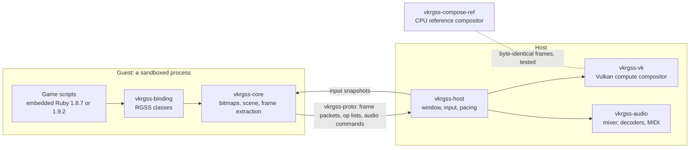

<p align="center"></p>

<h1 align="center">vkrgss</h1>

<p align="center"><b>Classic RPG Maker. Modern Rust + Vulkan.</b><br>The games of RPG Maker XP, VX and VX Ace on Linux, pixel for pixel, byte for byte.</p>

<p align="center">
  <a href="https://www.rust-lang.org/"></a>
  <a href="https://doc.rust-lang.org/edition-guide/rust-2024/"></a>
  <a href="https://www.vulkan.org/"></a>
  
  <br>
  
  
  
  <br>
  <a href="https://github.com/xuyanwen2012/vkrgss-rs/actions/workflows/ci.yml"></a>
  <a href="https://github.com/xuyanwen2012/vkrgss-rs/releases/latest"></a>
  <a href="LICENSE"></a>
</p>

A Rust + Vulkan runtime for RPG Maker games on Linux. RPG Maker XP (RGSS1), VX (RGSS2) and
VX Ace (RGSS3) are supported. The game's scripts run in an embedded Ruby, 1.8.7 or for VX
Ace 1.9.2, inside a sandboxed process; every frame is composed by one Vulkan compute
dispatch and proven against the original runtime. Versions 0.1.0 to 0.3.0 were released
under the name vkxp ([what changed](docs/running.md#coming-from-vkxp-030)).

## What is new here

### A whole 2D engine in one compute shader, bit-exact on any GPU

The original draws sprites, planes, windows, tilemaps and viewports, with tone, flash,
opacity, blend modes and wave effects, in software on the CPU. vkrgss turns each frame into
an ordered op list and evaluates it in **one compute dispatch**:
[`compose.comp`](crates/vkrgss-vk/shaders/compose.comp), 16 by 16 tiles, one invocation per
pixel, bindless bitmaps indexed with `nonuniformEXT`. GPU renderers usually accept that
vendors round floats differently. This one does not: integer arithmetic only, 64-bit
products emulated, texels fetched and never filtered. A frame is the same bytes on every
conformant driver, and a pure-Rust CPU compositor is held byte-identical to it by
differential tests of every message stream.

### A closed runtime reproduced by measurement, not by guessing

`cargo xtask oracle` runs the original runtime under Wine in a sandbox, drives it with
scripted input and diffs its frames with vkrgss's, pixel by pixel. Every rule found that
way is written down as a testable requirement in [`openspec/specs`](openspec/specs). The
result goes past "looks right": a save written at the same frame is **byte for byte the
original's**, in a game of XP, of VX and of VX Ace, which takes the original's Marshal
symbol order, random generator and float text exactly. Text widths are those of GDI: the
FreeType auto-hinter Wine uses is reproduced in Rust, and all 28,392 measured advances
agree. Outside text glyphs, the frames of the regression corpus are pixel-identical.

### Save states in any game, by forking the interpreter

A Ruby 1.8 or 1.9 interpreter cannot be serialised: the script is suspended halfway down
the C stack. So vkrgss does not try. A save state is a **copy-on-write `fork` of the whole
guest process**, taken between two frames: instant, and the game never knows. It took
patches to Ruby itself, which rebuild the timer thread in the copy and make the global VM
lock fair, so that a copy never stalls.

### Browser-grade isolation for a 2005 game engine

The game's scripts are untrusted code reading untrusted files, so they get the treatment a
browser gives a web page. In a window they run in a guest process that, before the first
script, confines itself with **Landlock**: it writes only below the game directory,
executes nothing and opens no TCP connection. The GPU, window, audio and input stay in the
host. The two share no memory and exchange only plain data defined in `vkrgss-proto`. A
crafted save file meets a locked process, not your desktop.

### Interpreters from 2010 and 2013, rebuilt for 2026

No installed Ruby is involved. Ruby 1.8.7, Ruby 1.9.2 and Oniguruma are vendored,
hash-checked and built by `build.rs` with today's GCC and clang, carrying 62 recorded
patches: faults that modern optimisers expose (a computed `goto` on an integer, a fiber
stack copy that the compiler broke), backported CVE fixes, and symbol isolation so that the
two interpreters never meet in one binary. libFuzzer targets for `Marshal.load`, the parser
and the regex engine run under AddressSanitizer and UndefinedBehaviorSanitizer, and the
upstream suites run under a garbage-collector stress run. Every later security fix of Ruby
1.8 and Oniguruma is reviewed in [docs/vendored-security.md](docs/vendored-security.md); the
same work for Ruby 1.9.2 is the next change.

### Presentation on the newest Vulkan timing extensions

Raw Vulkan through `ash`, with dynamic rendering and `synchronization2`. With
`VK_EXT_present_timing` and `VK_KHR_present_wait2` each present is scheduled for the game's
own frame time, so a 40 fps game is paced by its clock rather than by the display's.
sRGB swapchains are presented exactly through a mutable-format view, and every Vulkan test
runs under the Khronos validation layer in CI, where an error fails the test.

### Deterministic end to end

Hash seed fixed, random seed recorded, input recorded: a replay gives the same frames, and
a headless run writes PNG frames that reproduce byte for byte. The runtime becomes a
function that can be tested, and over 3,000 tests do.

<p align="center">
  
  
</p>

Frames of [Legendary Warband](https://github.com/xuyanwen2012/XP-MBBS-7.0), an RPG Maker XP
game, as vkrgss renders them headless.

## Classic RPG Maker

| Runtime | State | |
|---|---|---|
| RPG Maker XP (RGSS1) | Supported | Since version 0.1.0 |
| RPG Maker VX (RGSS2) | Supported | Since version 0.2.0 |
| RPG Maker VX Ace (RGSS3) | Supported | Since version 0.3.0 |

The runtime is read from `Game.ini`. Integer or filtered scaling, borderless fullscreen,
encrypted archives, Ogg, WAV, MP3 and SoundFont MIDI, gamepads and remappable keys,
fast-forward, recording and replay. Known gaps: text glyphs are not rasterised as GDI does,
so their pixels differ while layout and widths are exact, and only Linux x86_64 is built;
[docs/compatibility.md](docs/compatibility.md) has the full list.

## Quick start

Prerequisites: a C compiler, `glslc`, `spirv-val`, the development files of libcrypt, ALSA
and libudev, and a Vulkan 1.3 device; see [docs/building.md](docs/building.md). The Rust
toolchain is pinned in `rust-toolchain.toml`.

```sh
cargo build --release -p vkrgss -p vkrgss-guest-rgss3
```

A game expects the `RPG` module of the original runtime. That Ruby source is Enterbrain's
and is not part of this repository; one command copies it from an RGSS DLL of your own
(VX and VX Ace need their own file; see [docs/running.md](docs/running.md)):

```sh
mkdir -p ~/.local/share/vkrgss
cargo xtask extract-rpg <RGSS DLL> ~/.local/share/vkrgss/rpg_builtin.rb
target/release/vkrgss <game directory> --rtp Standard=<RTP directory>
```

The Vulkan loader loads the driver of every GPU in the machine unless it is restricted; to
leave the others alone, set `VK_LOADER_DRIVERS_SELECT` and `--device`, for example
`VK_LOADER_DRIVERS_SELECT='*radeon*'` with `--device RADV`.

Arrow keys move, Space or Enter confirms, Escape cancels, Tab held fast-forwards, F12
resets, Alt+Enter or F11 toggles fullscreen, F3 and F4 save and load a state. Every
option, the configuration files and the key maps are in [docs/running.md](docs/running.md).

## How it works



Each frame the guest sends an ordered list of ops of five kinds, and both compositors
evaluate every kind per pixel. The protocol is at version 15, which added the start and the
return time of the music to the play command, and the volume command. Ruby 1.8.7-p374 with
Oniguruma 5.9.6 serves XP and VX; Ruby 1.9.2 is linked by `vkrgss-guest-rgss3` alone, the
guest executable for VX Ace. A headless run of XP or VX may keep the guest on a thread.
[docs/architecture.md](docs/architecture.md) has every crate and the dependency rules,
which `cargo xtask deps` enforces.

## Documentation

- [docs/running.md](docs/running.md): every option, configuration, gamepads, audio, the
  headless mode, save states, recordings and the sandbox.
- [docs/building.md](docs/building.md): prerequisites and how tests choose a device.
- [docs/architecture.md](docs/architecture.md): the crates, the protocol, the rules.
- [docs/development.md](docs/development.md): the merge gate, fuzzing, the oracle, OpenSpec.
- [docs/compatibility.md](docs/compatibility.md): what is exact and what differs.
- [docs/decisions.md](docs/decisions.md): the settled decisions and the milestones.
- [docs/vendored-security.md](docs/vendored-security.md): the security review of the C.
- [docs/releasing.md](docs/releasing.md) and [CHANGELOG.md](CHANGELOG.md).

## Contributing

[CONTRIBUTING.md](CONTRIBUTING.md) describes the build, the merge gate
(`VK_LOADER_DRIVERS_SELECT='*lvp*' cargo xtask gate`) and the OpenSpec workflow.

## Licence and legal

MIT; see [LICENSE](LICENSE). The bundled third-party source keeps its own terms, which
[THIRD-PARTY.md](THIRD-PARTY.md) lists.

vkrgss is an independent project. It is not affiliated with, endorsed by or sponsored by
Enterbrain, KADOKAWA or Gotcha Gotcha Games. RPG Maker is a trademark of its owner; Rust and
Vulkan are trademarks of the Rust Foundation and of the Khronos Group, named here only to say
what vkrgss is built with. The repository contains no code, script or asset of the original
runtime or of the run-time package; to run a game you need the game and the files it requires.
